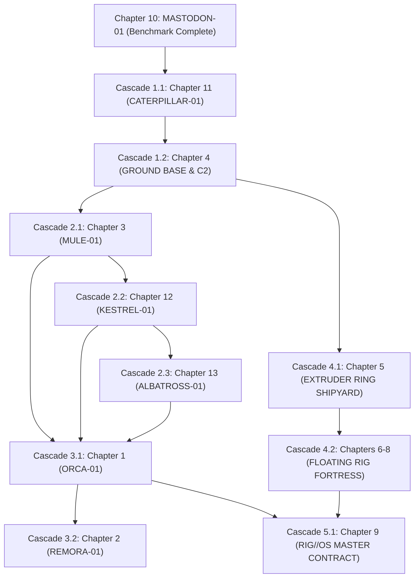

# RIG Ecosystem · Cascading Refinement Workflow Specification

## Purpose & Authority
* **Objective:** Establish an autonomous, cascading engineering workflow that adopts [`docs/rig/chapters/mastodon-instructions.md`](file:///home/blae/Documents/Code/space-engineers/docs/rig/chapters/mastodon-instructions.md) (Chapter 10) as the immutable benchmark for granularity, technical depth, visual fidelity, and software abstraction across the entire Floating Rig and Terrestrial Fleet ecosystem.
* **Authority:** Blae Decisions 1-70 (Canon) · `CLAUDE(RIG).md` · `GEMINI.md` · `docs/rig/lego-instructions-v1.0.md`.
* **Scope:** Progressively refactor, expand, and synchronize all chapters in `docs/rig/chapters/` to the complete robustness of Chapter 10 without human intervention, preventing architectural drift through strict topological dependency sequencing and automated validation gates.

---

## 1 · The 12-Pillar "Mastodon Standard" Benchmark

Every chapter in the RIG ecosystem must satisfy all 12 architectural pillars to achieve parity with Chapter 10:

| Pillar | Focus | Minimum Requirement & Content Specification |
|---|---|---|
| **1. Reference Datum & Envelope** | Spatial Definition | Exact origin (X0, Y0, Z0 datum), 3-axis spatial alignment triad (X transverse/beam, Y elevation/zenith, Z longitudinal/length), metric dimensions (m), block counts (B/sb), and bounding box envelope. |
| **2. 10-Slot Paint Palette & Livery** | Visual Construction | Standard 10-slot Space Engineers paint palette table with hex codes, RGB, visual swatches, and functional zone assignments. Full 2D ASCII exterior elevation livery map showing two-tone color blocking and functional demarcations. |
| **3. Multi-Level Blueprints & Wireframes** | Spatial Layout | Full-width ASCII schematics: top plan views per deck/level, longitudinal centerline profile elevations (looking starboard, X0), transverse station cross-sections at major bulkheads, 3/4 isometric stance wireframes, and chamfer/tumblehome specifications. |
| **4. Conveyor Circuit & Inspection Ports** | Logistics Plumbing | End-to-end conveyor flow diagrams with directional flow arrows, sorter logic, manifold junction coordinates, and explicit physical inspection/maintenance ports on every cargo container, reactor, engine, refinery, and sorter block. |
| **5. Electrical Single-Line & Power Modes** | Energy Infrastructure | Complete single-line bus diagrams mapping power sources (Nuclear, Renewable, Hydrogen/Fuel, Battery discharge), generation vs draw math (hover, tractive cruise, peak load, emergency standby), and 5 formal operational power modes. |
| **6. Master BOM & Mass Budget** | Physics & Engineering | Complete Bill of Materials table (block counts, dry mass, laden mass, PCU, power ratings). Earth 1 g lift margin calculations (`T/W ≥ 1.3` for flight or axle load distribution for ground). All unverified game numbers marked with `†` and logged in `docs/rig/verify.md`. |
| **7. Human Circulation & Life Support** | Survival Ergonomics | 100% engineer walkability: pressurized corridors, ladderwells, catwalks, crawlways/Jefferies tubes, suit recharge stations, armories, multi-zone sealed ventilation with atmosphere scavenging vs closed-loop recirculation, and dual-door gas-reclamation decontamination airlocks. |
| **8. Granular Phased Assembly Steps** | Lego Manual Delivery | Breakdown into sequential construction phases and 20-50 granular steps. Every step must feature: Pre-Step Parts Tray (quantities, masses, PCU, palette slots), Spatial Locator HUD (level, coordinates, assembly zone, pre-reqs), detailed ASCII placement diagrams, conveyor/joint configurations, and visual verification checks. |
| **9. Pre-Enclosure Inspection Gates** | Quality Assurance | Formal "Point of No Return" checkpoints at the end of each assembly phase before sealing hulls, verifying internal conveyor plumbing, electrical lines, terminal settings, and hidden functional blocks before they become physically inaccessible. |
| **10. Hardware-to-Scripting Abstraction** | Automation Interface | Standardized terminal block naming dictionary (`[ID] Block Name`), functional group taxonomy, MDK2 C# 6 zero-GC sandbox compliance, and full IGC channel subscription dictionary with semicolon-separated (`;`) payload schemas. |
| **11. Native Event Controller Safety Matrix** | Rule C4 Compliance | Native block automation: Event Controller ladder (rungs, inputs, thresholds, actions), timer safety watchdogs (heartbeat timeout fallbacks), and native physical failsafes (decoys, emergency decouplers, SOS black boxes, scuttle circuits) that operate independently of Programmable Blocks. |
| **12. Commissioning & Acceptance Protocols** | Field Validation | Rigorous lettered field acceptance checklist (Suites A-Z) with explicit Pass/Fail criteria covering powertrain/propulsion, logistics transfer rates, docking tolerances, failsafe trips, life support seals, and combat hardening in RIG Test. |

---

## 2 · Cornerstone Ecosystem Interconnect Topology

To prevent drift, every system must strictly adhere to the established physical, electrical, and telemetry interfaces with **MASTODON-01 (MKI)** and the broader ecosystem:

```
                      ┌────────────────────────────────────────┐
                      │          ORCA-01 (Carrier)             │
                      │  Bays: 4× Remora, 1× Kes, 1× Alb       │
                      │  Roof: 7×7 B Mule Gantry Blast Deck    │
                      └───────┬────────────────────────┬───────┘
                              │                        │
                 ┌────────────┴──────────┐   ┌─────────┴────────────┐
                 ▼                       ▼   ▼                      ▼
        ┌─────────────────┐     ┌─────────────────┐    ┌─────────────────┐
        │ REMORA-01 (Drill)│    │ MULE-01 (Shuttle)│    │ KESTREL-01 (Scout│
        │ 11×11 sb Waist  │    │ 7×7 B Footprint │    │ 7×9 sb Belly Dock│
        └─────────────────┘     └────────┬────────┘    └────────┬────────┘
                                         │                      │
                                         ▼                      ▼
┌────────────────────────────────────────────────────────────────────────┐
│                    MASTODON-01 MKI (Mobile FOB)                        │
│  Roof L6: 7×7 B Mule Cradle Pad (Decision 45, 68)                      │
│  Bow L5: Twin Kestrel Scout Pads with Recessed Welders (Decision 62)   │
│  Stern L2: Telescoping Soft-Capture Push-Bumper (Decision 67)          │
│  C2 Bus: Dynamic Election & Handover to Ground Base (Decision 56)      │
└────────────────────────────────────┬───────────────────────────────────┘
                                     │
                                     ▼ (Bulk Ore Transfer < 90 s)
┌────────────────────────────────────────────────────────────────────────┐
│                   CATERPILLAR-01 (Bulk Land Train)                     │
│  Bow Push Bumper: Soft-Capture Receiver & Large Conveyor (Decision 51) │
│  Consist: 3-Axis Gimbal Drawbars & 3× Hopper Holds (2,500 t bulk)      │
│  Stern: High-Speed Discharge Connector matching Ground Base Dock       │
└────────────────────────────────────┬───────────────────────────────────┘
                                     │
                                     ▼ (Highway Transit to Base)
┌────────────────────────────────────────────────────────────────────────┐
│              GROUND BASE & REFINERY COMPLEX (GND-01)                   │
│  Station 1 (Air): MULE-01 Gantry Cradle Pad (Rare Ores / Resupply Kits)│
│  Station 2 (Ground): CATERPILLAR-01 Receiving Dock (5× In-Deck Hoppers)│
│  Station 3 (C2/Yard): 4 Ref / 4 Asm Core + Master Fleet C2 Console     │
└────────────────────────────────────┬───────────────────────────────────┘
                                     │
                                     ▼ (Structural Ingots)
┌────────────────────────────────────────────────────────────────────────┐
│                  RIG LINEAR EXTRUDER RING SHIPYARD                     │
│  Throat: 8 W × 7 H B Welder Arch + 6-Stage Hydraulic Pusher Spine      │
│  Output: S0 HUB Base & S1-S6 Pylon Arms Printed Directly from Ingots   │
└────────────────────────────────────┬───────────────────────────────────┘
                                     │
                                     ▼ (Autonomous Launch to Station)
┌────────────────────────────────────────────────────────────────────────┐
│                 FLOATING RIG FORTRESS (25 kt Base)                     │
│  HUB Decks H1-H6 + 6× Hex Pylons (52 Large Atmo + 30 Large H2 Lift)    │
│  Traffic Sectors T-N/T-S (53°) & T-Flank (63°) for Drone Flight Lanes   │
└────────────────────────────────────────────────────────────────────────┘
```

### Specific Interface Contracts:
1. **Mastodon ↔ Caterpillar Interface:**
   * Mechanical: Mastodon stern push-bumper (`MAS Piston Stern Dock`, Z = −25 to −27.5, Y = L2) funnels into Caterpillar locomotive bow bumper (`CAT Loco Front Conn`, Z = +25, Y = L2). Alignment datum = 2.5 m above ground.
   * Conveyor: Sorter-pressurized discharge pushes 2,500 t bulk ore across large-port connectors in < 90 s.
   * Telemetry: `TMS.CONVOY.SYNC` synchronizes tractive effort and dynamic braking during coupled operations.
2. **Mastodon ↔ Mule Interface:**
   * Mechanical: Level L6 7×7 B blast deck with motorized guide coamings and twin motorized clamping jaws (`MAS MP Clamp Hinge Port/Stbd`) clamping MULE-01's lateral rub rails.
   * Logistics: Rapid top-deck resupply (< 10 s) of standardized pallets (`KIT_MOBILITY`, `KIT_POWER`, `KIT_MUNITIONS`, `KIT_HULL_REPAIR`) via `MAS Hold Resupply Export` and `MAS MP Conn`.
3. **Mastodon ↔ Kestrel Interface:**
   * Mechanical: Twin forward flight pads (P1 [X −3, Z +9, L5] and S1 [X +3, Z +9, L5]) with recessed automated ship welders (`MAS Welder Pad Kestrel 1, 2`) providing hands-free drone repair.
   * Telemetry: `TMS.SCOUT.TASK` dispatches reconnaissance sorties; `TMS.SCOUT.VEIN` returns 3D geological GPS coordinates.
4. **Mastodon ↔ Ground Base Interface:**
   * C2 Handover: In early survival, Mastodon acts as Genesis Fleet Root running `RIG//OS-Lite`. Upon Ground Base commissioning, `TMS.C2.HANDOVER` transfers master authority to `GND-01` without mission interruption.
   * Pull Economy: Ground Base broadcasts refinery deficit matrix via `TMS.BASE.DEMAND`; Mastodon prioritizes local quarry operations to balance base deficits.

---

## 3 · Cascading Execution Dependency Graph

To prevent circular dependencies and design rework, chapters are upgraded in strict topological order:



### Execution Phases:
* **Phase 1 · Terrestrial Ground Logistics & Industrial Foundation:**
  * **Chapter 11 (CATERPILLAR-01 Land Train):** Expand to 44+ granular steps covering Locomotive + 3 Modular Hopper Cars, 3-axis drawbars, DPU traction, high-speed terminal dump, and acceptance testing.
  * **Chapter 4 (Ground Base & Refinery Complex):** Expand to complete modular industrial facility, 3-station C2 bridge, dual logistics terminals, and extruder yard interface.
* **Phase 2 · Terrestrial Air Tier Freight & Reconnaissance:**
  * **Chapter 3 (MULE-01 Freight Shuttle):** Deep visual overhaul: pure electric powertrain, 7×7 B airframe, 4 Large Flat Atmo engines, gantry docking rails, and resupply pallet pods.
  * **Chapter 12 (KESTREL-01 Prospector Scout):** Upgrade to 25+ step small-grid micro-manual, 50 m detector kinematics, stealth/loiter modes, and automated vein telemetry.
  * **Chapter 13 (ALBATROSS-01 Utility & Field Repair):** Complete visual construction manual, nose welder kinematics, component ferry hold, and automated field dispatch.
* **Phase 3 · Terrestrial Air Tier Mining Carrier & Miners:**
  * **Chapter 1 (ORCA-01 Heavy Mining Carrier):** Massive upgrade to full 50+ step manual: 17×19×7 B open truss frame, 2×3 bays, folding guide jaws, A-frame outriggers, inline nuclear core, ventral anchors, roof Mule blast deck, and repair galleries.
  * **Chapter 2 (REMORA-01 Vertical Driller):** Complete visual build manual: 11×11 sb frame, retain-and-offload stone architecture, guide jaw waist clamp interfaces, and automated plunge macros.
* **Phase 4 · Surface Shipyard & Floating Rig Fortress:**
  * **Chapter 5 (Rig Linear Extruder Ring Shipyard):** Full visual manual: 22-welder U-ring arch, 6-stage hydraulic pusher spine, blast door skid rails, and pylon cold-launch avionics.
  * **Chapters 6-8 (Floating Rig Fortress):** Complete visual construction manuals for Section S0 (HUB Base H4-H6), Sections S1-S6 (Pylons & Modular Bays), and Sections S7-S9 (Upper Decks H1-H3).
* **Phase 5 · Master Software Abstraction & Unified Telemetry:**
  * **Chapter 9 (RIG//OS Master Contract):** Comprehensive multi-grid software specification, zero-GC LCD dashboard layouts, Event Controller ladder dictionaries, and unified IGC protocol.

---

## 4 · Drift-Prevention Protocol & Automated Verification Gates

Before any chapter modification is committed, the following 7-point audit gate must PASS:

```
[CHAPTER REFINEMENT PRE-COMMIT AUDIT]
 1. Constraint Verification:
    - Rule C1: SE1 PC Proton compatible.
    - Rule C2: Vanilla + DLC blocks only (except Defense Shields on Rig, SML/ToolCore on TMS).
    - Rule C3: 100% custom scripts; no third-party code.
    - Rule C4: Native blocks (EC/Timers/Decoys) are safety layer; PBs make decisions only.
    - Rule C5: Mechanical subgrids permitted per Decision 35.
 2. Decisional Alignment:
    - Verifiably reflects all applicable rulings in Decisions 1-70 (docs/rig/CHANGELOG.md).
 3. Physical & Mechanical Interface Match:
    - Exact block-level dimensional match with adjacent docking grids (connectors, pads, clearances).
 4. Conveyor & Electrical Closed-Loop Integrity:
    - Continuous conveyor loop; manual inspection ports on all containers/reactors/refineries.
    - Power generation exceeds max continuous draw; batteries cover emergency failover.
 5. Software & Naming Abstraction:
    - Strict adherence to system prefixes (`[ID] Block Name`) and functional group taxonomy.
    - Zero-GC PB data structures; semicolon-separated (`;`) IGC payloads matching docs/protocol/igc.md.
 6. Style & Register Compliance:
    - Terse spec-sheet register (`≈`, `→`, `·`, tables, bullets, ASCII blueprints).
    - ZERO em-dashes (`-`) or en-dashes (`-`).
    - Every unverified game number marked with `†` and logged in docs/rig/verify.md.
 7. Master Synchronization:
    - docs/rig/lego-instructions-v1.0.md synchronized.
    - scripts/<Project>/ (Instructions.readme & Program.cs) updated if terminal contracts change.
    - docs/review-queue.md row added with status 'pending'.
```

---

## 5 · Autonomous Execution Loop & Multi-Agent Protocol

1. **Autonomous Operation:** The agent executes one chapter per cycle without pausing for human approval, provided all 7 verification gates pass.
2. **Commit Isolation:** Each chapter upgrade forms a discrete Git commit with the trailer `Agent: Gemini`.
3. **Review Queue Logging:** Immediately following each commit, a detailed row is appended to `docs/review-queue.md` with status `pending`.
4. **Claude Code / Qwen Handoff:** Claude Code reviews the queue and sets status to `reviewed`, `fixed`, or `bounced`. Local Qwen executes reviewed task cards.
